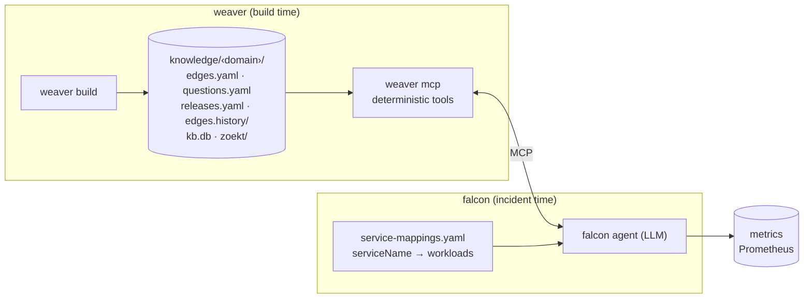

# Weaver and Falcon: Overview

Two tools that together answer the incident question **"what broke, why, and
what does it affect?"** for a set of services:

- **Weaver** works out, from source code, which service depends on what.
- **Falcon** combines that with what is happening live, indentifies drift and analyses incidents.

---

## 1. Weaver: knowledge from code

Weaver reads every service of a **domain** at its release branch and builds
static knowledge about it:

- **Service map** (`edges.yaml`):
  - nodes: services, Kafka clusters, Redis, databases, Ceph, external systems;
  - edges: the calls between them;
  - for every call, where it is made, which endpoint handles it, and whether
    its failure reaches the caller (`call: required / optional / fallback / async`).
- **Exact code references** from SCIP: definitions, references, call chains,
  entry points.
- **Code text** in Zoekt, for every release.
- **Releases and history:** which commit and version was built, and how each
  service's edges changed between releases.
- **Questions** for whatever the code can't tell. Weaver never guesses; it
  asks, and `weaver answer` records the answer and who gave it.

Every build has a build id, the generation it wrote, and a run id derived from
the exact sources it built, and every
output carries it.

→ Details: [weaver-architecture.md](weaver-architecture.md), which links every
weaver spec, and [weaver-features.md](weaver-features.md).

---

## 2. Falcon: incident analysis

Falcon tries to do what an engineer does during an incident, faster. It
combines:

- **Live data:** metrics.
- **Static knowledge** from weaver, and from any other knowledge source that
  speaks MCP (runbooks, tickets, docs).
- **An LLM agent** (a local LLM) that plans the investigation, calls tools and
  writes the root-cause analysis, citing a source for every fact.

To analyse incidents on correct ground, falcon **identifies drift**
(`falcon drift-detect domain <name>`): where what the code says differs from what is
running (versions, dependencies, infrastructure, the mapping from services to
workloads). Drift is not analysed for its own sake. It is evidence for an
incident ("the deployed version isn't the analysed one", "this call isn't in
the code map"), and a reason to fix weaver's knowledge.

→ Details: [falcon-architecture.md](falcon-architecture.md), which links every
falcon spec.

---

## 3. How falcon uses weaver

Falcon reads weaver's knowledge **only through the MCP tools** of `weaver mcp`
(mcp-spec). It never reads weaver's files directly. The tools contain no
LLM; falcon's agent decides which to call.

| Falcon needs to…                                                        | Weaver gives it                                                            | Tool                                           |
| ------------------------------------------------------------------------ | -------------------------------------------------------------------------- | ---------------------------------------------- |
| Map an alert's workload to a service                                     | the join key `serviceName` (falcon's `service-mappings.yaml`)           | —                                             |
| Know what a failing endpoint depends on, and which of those calls matter | edges with `call` criticality, and the entry points that reach each call | `entries`, `edges`, `blast`              |
| Know what a failing service affects                                      | callers whose failure propagates (`required`)                            | `blast`                                      |
| See what changed before the incident                                     | releases and edge diffs between them                                       | `releases`, `diff`                         |
| Check the code that is actually running                                  | code text at the deployed release                                          | `read`, `search`                           |
| Follow the call chain to its cause                                       | exact definitions, references, callers                                     | `definition`, `references`, `call_chain` |
| Resolve a constant or config value                                       | the value and where it comes from                                          | `constant_value`, `config`                 |
| Know what weaver couldn't see                                            | open questions and the edges waiting on them                              | `questions`                                  |

**Trust:** weaver's facts are exact unless marked; the markers and what falcon does with them are
in [falcon-architecture.md](falcon-architecture.md) §4.

**Drift:** weaver's knowledge is the static side of the drift falcon identifies
([drift-spec.md](drift-spec.md)).

---

## 4. Documents

| Document                                        | For                       | Covers                                                            |
| ----------------------------------------------- | ------------------------- | ----------------------------------------------------------------- |
| [weaver-architecture.md](weaver-architecture.md) | weaver                    | building blocks, build pipeline, data, design decisions           |
| [weaver-features.md](weaver-features.md)         | weaver                    | every feature                                                     |
| [analyzer-spec.md](analyzer-spec.md)             | weaver                    | language analyzers, the facts they report, weave-ai's review       |
| [edges-spec.md](edges-spec.md)                   | weaver → falcon contract | the service map: nodes, edges, criticality, override, validation  |
| [questions-spec.md](questions-spec.md)           | weaver                    | questions and `weaver answer`                                   |
| [build-spec.md](build-spec.md)                   | weaver                    | run id, releases, edge history, code versions, internal libraries |
| [mcp-spec.md](mcp-spec.md)                       | weaver → falcon contract | the tools, `weaver mcp`, the tools weave-ai uses                |
| [falcon-architecture.md](falcon-architecture.md) | falcon                    | building blocks, incident flow, drift flow, rules                 |
| [drift-spec.md](drift-spec.md)                   | falcon                    | drift checks, results, report, accepting drift                    |
| [rca-spec.md](rca-spec.md) | falcon | the incident analysis record and its rendered page |
