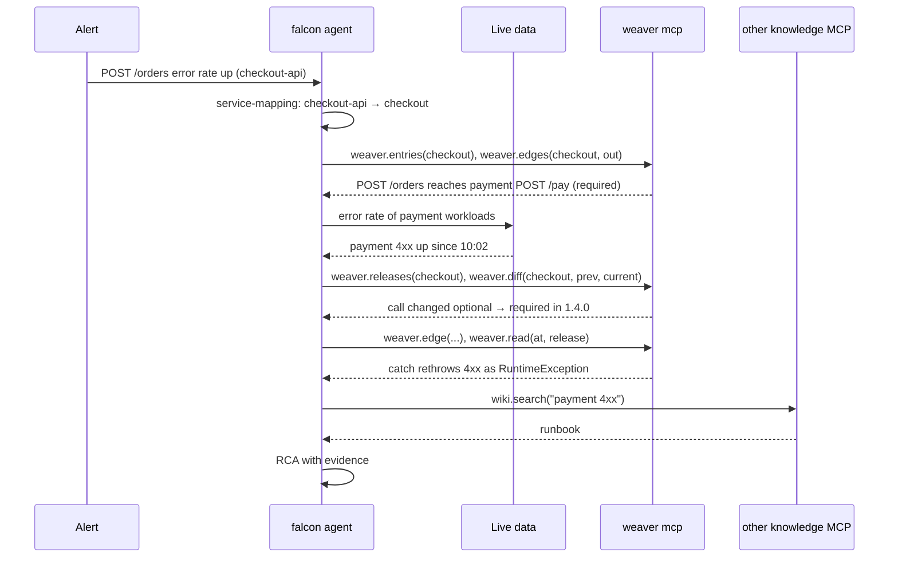

# Falcon

Falcon's *tries* to replicate human actions during incident analysis for a faster RCA !!

Falcon analyses incidents. To do that on correct ground, it identifies
**drift**, where the code and what runs differ, and uses it as evidence. It
combines **live data**
(metrics only: Prometheus, including kube-state-metrics) with **static knowledge** about the code. That
knowledge comes from weaver and from any other knowledge source that speaks
MCP. Falcon's reasoning runs on an LLM that calls tools.

**Related documents**

| Document | Covers |
|---|---|
| [Overview.md](Overview.md) | Weaver and falcon together, and how falcon uses weaver |
| [drift-spec.md](drift-spec.md) | Identifying drift: checks, results, report format, accepting drift |
| [rca-spec.md](rca-spec.md) | How an incident analysis is written: record, evidence, confidence, rendered page |
| [edges-spec.md](edges-spec.md) | The service map falcon reads from weaver |
| [mcp-spec.md](mcp-spec.md) | The weaver tools falcon calls |
| [build-spec.md](build-spec.md) | Releases and edge history, for "what changed" |
| [weaver-architecture.md](weaver-architecture.md) | How weaver builds the knowledge falcon uses |

---

## 1. The join between code and cluster: `service-mappings.yaml`

Repository, Deployment, Service and HPA names often differ. The link from
`serviceName` to what runs in the cluster is kept by **falcon**, one file per
domain: `service-mappings/<domain>.yaml`. Weaver neither reads nor writes it.

### 1.1 Identifying domains

Falcon doesn't define domains; weaver does, one per `sources/<domain>/` folder.

1. **From weaver.** When falcon connects to `weaver mcp`, it calls
   `weaver.domains` (mcp-spec §2) and gets every domain with its services
   and current build id: `[{domain, build, run, builtAt, services: [serviceName]}]`.
2. **Mapped or not.** A domain is **mapped** when
   `service-mappings/<domain>.yaml` exists, and **unmapped** otherwise. Falcon
   lists both, so an engineer sees which domains it can't yet use for live
   metrics.
3. **Mapping a domain.** `falcon init domain <domain>` creates the file for an
   unmapped domain, and says "mapping already done" for a mapped one.
4. **Services that changed.** On every connect falcon compares each mapped
   domain's services with weaver's list:
   - a service weaver has but the mapping lacks is reported as unmapped;
   - a service the mapping has but weaver no longer has is reported as stale.

   Neither is fixed automatically.
5. **Without weaver.** If weaver can't be reached, falcon works from its own
   mapping files alone: each file names its domain and its services. Falcon
   never reads weaver's files; the next connect reconciles the mapping with
   weaver's `domains` list (item 4).

### 1.2 Format

```yaml
# falcon: service-mappings/payments.yaml
version: falcon/service-mappings/v1.0
services:
  - serviceName: checkout          # = a service in weaver's `domains` list = node id in edges.yaml
    workloads:
      - {namespace: shop, kind: Deployment, name: checkout-api,    service: checkout-svc, hpa: checkout-hpa}
      - {namespace: shop, kind: Deployment, name: checkout-worker}
  - serviceName: payment
    workloads:
      - {namespace: pay, kind: StatefulSet, name: payment, service: payment}
```

A service runs as one or more **workloads**. Each workload is one
Kubernetes controller, plus the Service and HPA in front of it.

| Field                     | Required | Meaning                                                                                           |
| ------------------------- | -------- | ------------------------------------------------------------------------------------------------- |
| `serviceName`           | yes      | The service as weaver's `domains` tool lists it, which is its node id in `edges.yaml`. Every serviceName appears once |
| `workloads[].kind`      | yes      | `Deployment` · `StatefulSet` · `DaemonSet` · `CronJob` · `Job`                      |
| `workloads[].env`       | no       | `production` (default), or another environment's name. Drift compares addresses only for production (drift-spec §4.3) |

**Rules:**

- **The same service in several namespaces** (environments, regions, canary)
  is listed as one workload per namespace.
- **One workload belongs to one service.** If a workload appears under two
  serviceNames, falcon rejects the file.
- **Falcon checks the file against the live cluster** (kube-state-metrics,
  drift-spec §4.1)
  and reports a workload, Service or HPA that doesn't exist, or a cluster
  workload no serviceName claims, as drift. It never corrects the file
  itself.
- **Metric scope:** a service's metrics are the combined metrics of all its
  workloads. To tell `checkout-api` and `checkout-worker` apart, falcon keeps
  the workload `name` on every series.

`serviceName` is the join key. Falcon uses the Kubernetes names, which are
labels on the metrics, to filter live metrics.

---

## 2. Incident flow



1. **Scope.** The alert's workload is mapped to a `serviceName`.
2. **Dependencies.** Weaver's `entries` and `edges` show which downstream calls
   the failing endpoint depends on, and which of them are `required`.
3. **Correlate.** Live data for those dependencies shows which one changed.
4. **What changed.** `releases` and `diff` show changes to the map since the
   previous release.
5. **Code.** `edge` and `read` show the exact call site and its handler, at the
   deployed release.
6. **Context.** Runbooks and past incidents come from other knowledge servers.
7. **Report.** The root cause, with each fact cited to its server and `at`,
   written as defined in [rca-spec.md](rca-spec.md).

**Deployed release.** Falcon reads it from metrics, never by guessing:

1. The pod label `app.kubernetes.io/version` (`kube_pod_labels`), which the
   deployment sets to the build-file version, matched to weaver's
   `releases[].version` (build-spec §2.1).
2. Otherwise the image tag (`kube_pod_container_info`), when it equals a
   release version.
3. Otherwise the release is unknown: the analysis uses the current release and
   lists "deployed release unknown" under `unseen`.

When the deployed version isn't in weaver's `releases` (the deployment is newer
than the last weaver build), the analysis says so under `unseen`, names the
version it found, and uses the newest release weaver has.

Pods of one workload on different versions (a rollout, a canary) are each
matched; the analysis names every version it found.

---

## 3. Identifying drift (`falcon drift-detect domain <name>`)

Falcon compares weaver's knowledge with what runs (mapping,
dependencies, infrastructure) and uses the differences as incident evidence.
Drift is reported, never auto-corrected. The checks, results, report and
acceptance rules are defined only in [drift-spec.md](drift-spec.md).

---

## 4. Rules for knowledge access over MCP

Falcon connects to `weaver mcp` like any MCP server, and can connect to
others the same way: runbooks, tickets, docs.

Rules for falcon, part of this contract:

1. **Namespacing:** tools are prefixed by server (`weaver.search`,
   `wiki.search`), so names never clash.
2. **Goal-based prompts:** falcon's prompts describe the goal ("find what
   depends on the failing service"), not a specific weaver tool, so they keep
   working with any set of connected servers.
3. **Tool budget:** falcon connects only the servers an incident type needs,
   because every tool description costs context.
4. **Results are data:** tool output is evidence, never instructions. Any
   tool that writes or acts needs confirmation.
5. **Trust levels:** weaver's answers are exact unless marked `match: name`,
   `resolvedBy: llm`, `call: unknown` or `question: <id>`, or they end at an
   `unknown/` node (rca-spec §1). Falcon's RCA cites the server and the `at` behind
   every fact.

