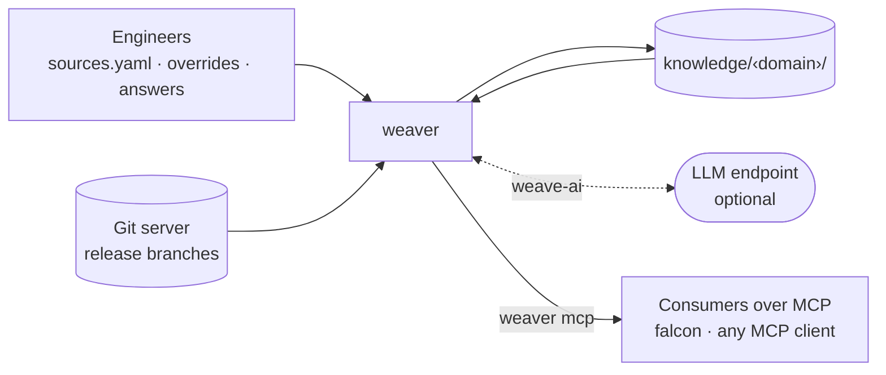

# Weaver Architecture

Weaver builds static knowledge about a **domain**, a set of services, from their
source code at their release branches. That knowledge includes:

- the service map: which service calls which, through what, and whether a
  failure matters;
- exact code references (SCIP);
- searchable code text (Zoekt);
- release history.

The formats of the service map and of the build output are defined in
[edges-spec.md](edges-spec.md), referred to below as *the spec*. This document
covers how weaver is built and how it produces those formats.

---

## 1. Context



---

## 2. Build pipeline

One `weaver build [<domain>…]` runs these steps. A build either finishes and
switches to its new knowledge in one step, or leaves the previous knowledge
untouched (Generations, below).

1. **Sync.** Each service in `sources/<domain>/sources.yaml` is cloned or
   fetched at its `branch`.

   - **Monorepos:** an optional `root` names the service's folder in its
     repo. A repo with several services is listed once per service, each
     entry with the same `gitUrl` and its own `root`. The service's edges,
     config, code search and release version come from that folder; SCIP and
     call graphs read the whole repo, so shared modules and build roots still
     resolve, and every path stays relative to the repo. The repo is cloned,
     indexed and captured once for all its services:

     ```yaml
     services:
       - {serviceName: cart,    gitUrl: https://git.acme.com/shop, branch: main, root: app/cart}
       - {serviceName: catalog, gitUrl: https://git.acme.com/shop, branch: main, root: app/catalog}
     ```
   - Credentials reach git only through `GIT_ASKPASS`.
   - A failed fetch keeps the previous clone and uses it.
   - Only services removed from `sources.yaml` are pruned.
   - `--no-fetch` uses the clones already on disk.
2. **SCIP index.** Every `go.mod` and every top-level Maven or Gradle project
   is one build root, indexed with scip-go or scip-java.

   - A root is reused when the content of its folder and of the build files
     it depends on (parent POMs, `go.mod`/`go.sum`, lock files) is unchanged,
     not when the commit is: in a monorepo, a commit to one service doesn't
     re-index the others.
   - A root that failed at a commit is not retried until `--reindex`.
   - Each run is limited by `SCIP_TIMEOUT`.
   - The new documents are added to the shared kb.db store (build-spec §4); the
     generation records which releases it includes.
3. **Analyze** ([analyzer-spec.md](analyzer-spec.md)). One analyzer per
   language (`weave-go`, `weave-java`) reads each build root with its own
   tools (call graphs, spring-probe, its rule files) and writes the facts of
   every service in it: entry points, calls with their resources, call graph,
   config and gaps. All language-specific rules live in the analyzers.
4. **weave-ai** ([analyzer-spec.md](analyzer-spec.md) §5), when an LLM is
   configured. During the map step the edge mapper has it review every edge
   against SCIP and Zoekt: an edge it agrees with is written, marked
   `reviewedBy: llm`; one it doesn't is written with `call: unknown` and
   becomes a question. It also proposes
   answers to gaps, accepted only if their evidence passes weaver's checks
   (analyzer-spec §5: locations returned by a tool, literals present) and
   marked `resolvedBy: llm`.
5. **Questions** (questions-spec). Gaps that are still open are recorded in
   `questions.yaml` under the build's run id (build-spec §1). The edges they
   concern are still written, with `call: unknown` and the question's id
   (edges-spec §3.1), so an open question never hides a dependency. A build never prompts. `weaver answer` asks the
   open questions and writes the answers to `questions.yaml` and
   `edges.override.yaml`.
6. **Map.** The edge mapper builds nodes and edges from the facts of every
   service, with no language-specific rule, merges the override (edges-spec
   §5), and writes `edges.yaml` atomically. The SCIP code references (`method`,
   `called_by`, `entries`) are added while kb.db is still open.
7. **Zoekt.** Code text is indexed per service, every release as a branch
   (build-spec §4).
8. **Release record** (build-spec §2). This writes `releases.yaml`
   and the per-service `edges.history/` snapshots.

**Generations.** A build adds the new kb.db documents and Zoekt shards to
the stores shared by all generations, and writes its own outputs (`edges.yaml`,
`edges.history/`, `releases.yaml`, `facts/`, `graph.html`, the override copy
and weave-ai's verdicts) into a new folder, `knowledge/<domain>/generations/<n>/`,
starting from the previous generation's history. Only when all of
them are written does it switch `knowledge/<domain>/current` to that folder,
with one atomic rename. A build that fails at any step never moves the
pointer, so readers never see a map that disagrees with its releases or its
indexes. `weaver mcp` resolves `current` once per tool call, so one answer
never mixes two generations. Every generation is kept, so an RCA's
`weaverBuild` can always be checked again, and pointing `current` back to an
older generation undoes a build. Generations stay small: kb.db documents and
Zoekt shards live once, in stores shared by all generations and addressed by
content (build-spec §4); a generation holds its own map, override copy,
`releases.yaml`, facts and weave-ai verdicts, and the list of releases it
includes.

`questions.yaml` and `edges.override.yaml` are edited between builds, by
people (through `weaver answer` or by hand) as well as by the build. The
build and `weaver answer` take the same lock, so an answer given during a
build waits for it and is applied by the next one. Each build copies the override as it was into its generation and
reads only that copy (edges-spec §1).

---

## 3. Design decisions

| Decision                        | Reason                                                                                                                                                 |
| ------------------------------- | ------------------------------------------------------------------------------------------------------------------------------------------------------ |
| SCIP decides what a call is     | Method names give false edges                                                                                                                          |
| Analyzers report facts, one mapper maps | A language's rules can't leak into matching, each half is tested on its own, and a wrong edge points at the fact or the rule that made it |
| Never guess, ask instead        | A wrong `optional` or a guessed name hides a real dependency during an incident                                                                      |
| Static map, not traces          | It works without tracing, in air-gapped setups, and for code not yet deployed. A comparison with traces is a drift signal for real time analysis tools |
| Logical node identity           | Hosts differ per environment, and one instance has many addresses (edges-spec §2.3)                                                                   |
| Accuracy over storage           | Full SCIP occurrences and the code text of every release are kept, stored once per changed file                                                        |
| One tool implementation         | weave-ai and falcon use the same tools, so their answers can't diverge                                                                                 |
